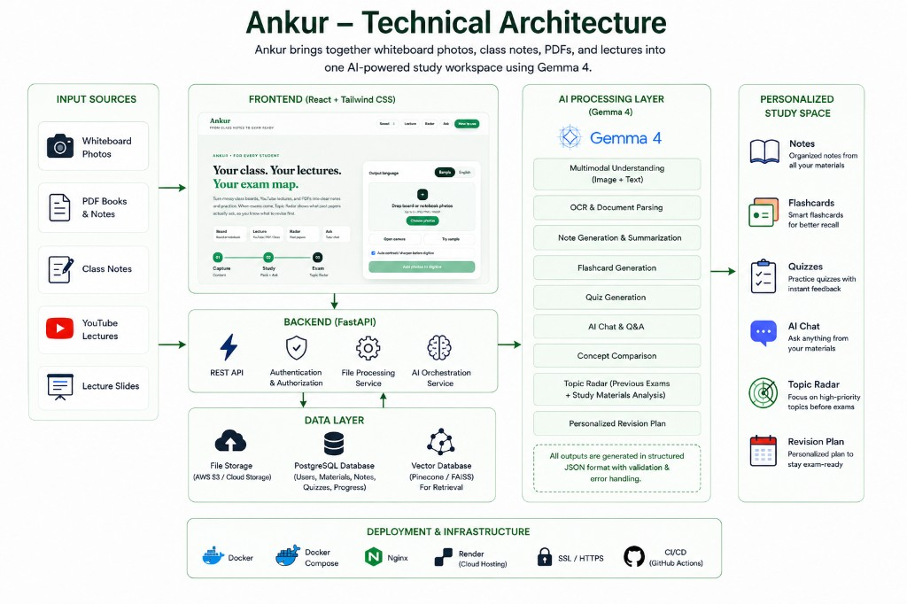
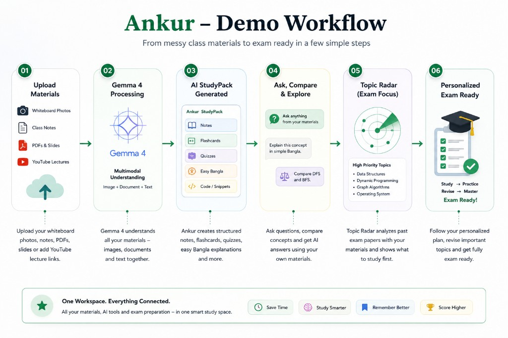

<div align="center">

# Ankur

**Ankur brings together classroom whiteboard photos, class notes, PDFs, and YouTube lectures into one AI-powered study workspace. Using Gemma 4, it creates personalized notes, flashcards, quizzes, simple explanations, and helps students prepare smarter for exams.**

*Build With Gemma @Bangladesh · Multimodal Track (Gemma 4)*

[](#how-gemma-is-used)
[](#technical-architecture)
[](#technical-architecture)
[](#run-it-yourself)

</div>

## Problem Statement

In Bangladesh, students collect study materials from many different places throughout the semester. They take photos of classroom whiteboards, download PDFs, save YouTube lectures, collect lecture slides, and write class notes.

When exams get close, everything becomes scattered. Students spend more time searching for files than actually studying. They often don't know which topics are most important, which lectures they have already covered, or what they should revise first.

Existing AI tools can summarize a document or answer questions, but they don't organize an entire semester of study materials into one connected learning experience.

Ankur solves this problem by bringing everything into one place and helping students learn, practice, revise, and prepare for exams with AI.

## Solution Overview

Ankur turns scattered study materials into one complete AI study workspace. Students can upload or save classroom whiteboard photos, class notes, PDF books, lecture slides, and YouTube lectures. Gemma 4 understands every resource and organizes everything into a connected knowledge base.

| Output | What you get |
|---|---|
| **Clean Notes** | Organized Markdown notes reconstructed from boards, PDFs, slides, and lectures |
| **Flashcards** | Smart flashcards for better recall — with more cards on demand |
| **Quizzes** | Practice quizzes with instant feedback — with harder questions on demand |
| **Easy Bangla** | Complex concepts translated into simple Bangla explanations |
| **Topic Summaries** | Clear topic-level summaries across all uploaded materials |
| **Ask Tutor** | AI-powered Q&A grounded in the student's own study materials |
| **Concept Comparison** | Side-by-side comparison of related concepts from the same materials |
| **Topic Radar** | Past exam questions × study materials → high-priority topics and gaps |
| **Revision Plan** | Personalized guidance to stay exam-ready |

Students can search across all their study materials, ask questions using their own notes, compare different concepts, and generate additional quizzes or flashcards whenever they need.

Before exams, **Topic Radar** analyzes previous exam questions together with the student's study materials and highlights the topics that deserve the most attention. Everything stays connected inside one simple study workspace — from the first class to the final exam.

## How Gemma Is Used

Gemma is the **core engine** of Ankur — every AI feature is powered by it.

- **Model:** [`gemma-4-26b-a4b-it`](https://ai.google.dev/gemma) via the Gemini API.
- **Why Gemma:** native multimodal understanding, strong Bangla and English support, reliable document/image understanding, long-context reasoning across multiple study materials, fast inference, and open-weight models for future offline deployment.

**Prompt / architecture decisions that make it work:**

1. **Multi-resource prompting** — whiteboard photos, notes, PDFs, slides, and lecture transcripts are understood together as one connected knowledge base.
2. **Structured JSON outputs** with low-temperature generation for consistent notes, quizzes, flashcards, Topic Radar, and revision guidance.
3. **Retrieval-based grounding** — every answer uses the student's own uploaded materials as context.
4. **Pydantic validation before rendering** — malformed model output is repaired or rejected, never shown broken to the student.
5. **Context-aware follow-ups** — Easy Bangla, Ask Tutor, more-quiz, more-flashcards, and Topic Radar reuse validated study packs as grounded context.

Ankur relies on prompt engineering and structured outputs instead of fine-tuning. Every AI feature uses the student's own study materials as context to provide accurate and consistent responses.

## Technical Architecture



**Stack summary:** React 19 + Vite + Tailwind + PWA (frontend) · FastAPI, Python 3.12 (backend) · Gemma 4 via Gemini API (intelligence) · Pydantic (validation) · PostgreSQL · Docker → deployed on Render (`render.yaml` included).

## User Flow



The complete workflow takes only a few simple steps:

1. Upload classroom whiteboard photos, class notes, PDFs, lecture slides, or YouTube lectures.
2. Gemma 4 understands and organizes all uploaded materials into a connected study workspace.
3. Ankur generates structured notes, flashcards, quizzes, and simple Bangla explanations.
4. Students can ask questions, compare concepts, and explore topics using their own study materials.
5. Before exams, Topic Radar analyzes previous exam questions together with the student's learning materials to recommend what should be revised first.
6. Students receive a personalized study experience that helps them learn, practice, revise, and prepare for exams from one place.

## Screenshots

> Screenshots will be added here. *(Home, processing, notes, flashcards, quiz, Topic Radar, Ask Tutor — send them when ready.)*

## Impact & Validation

Ankur helps students spend less time organizing study materials and more time learning.

- Brings all study materials into one place and organizes an entire semester automatically.
- Generates notes, quizzes, and flashcards from real classroom content.
- Makes difficult topics easier with simple Bangla explanations.
- Helps students find important topics through Topic Radar.
- Makes exam preparation faster, more organized, and more personalized.

The system was tested using real student study materials, including classroom whiteboard photos, handwritten class notes, lecture slides, PDF books, and YouTube lectures. Ankur successfully generated organized study notes, flashcards, practice quizzes, Easy Bangla explanations, AI-powered answers, topic summaries, personalized revision guidance, and Topic Radar recommendations.

## Run It Yourself

### Prerequisite

A free Gemini API key from [Google AI Studio](https://aistudio.google.com/apikey).

### Option A — Docker (fastest)

```bash
cp .env.example .env          # paste your GEMINI_API_KEY into .env
docker compose up --build     # open http://localhost:8000
```

### Option B — Deploy on Render

1. Fork/push this repo to GitHub.
2. [Render Dashboard](https://dashboard.render.com) → **New → Blueprint** → select the repo (`render.yaml` does the rest).
3. Set the `GEMINI_API_KEY` environment variable. Health check: `/api/health`.

### Option C — Local development

```bash
# 1. API key
cp .env.example .env                       # paste your GEMINI_API_KEY

# 2. Backend
python3 -m venv .venv
source .venv/bin/activate
pip install -r backend/requirements.txt

# 3. Frontend
cd frontend && npm install && npm run build && cd ..

# 4. Serve (FastAPI serves both the API and the built frontend)
cd backend && uvicorn main:app --host 0.0.0.0 --port 8000
# open http://localhost:8000
```

Hot reload during development:

```bash
cd backend && uvicorn main:app --reload --port 8000    # terminal 1
cd frontend && npm run dev                             # terminal 2 → http://localhost:5173
```

## API Reference

| Endpoint | Method | Purpose |
|---|---|---|
| `/api/health` | GET | Model + API-key status |
| `/api/generate` | POST | Image / materials → full study pack |
| `/api/lecture` | POST | YouTube and/or pasted text → study pack |
| `/api/topic-radar` | POST | Past papers + study history → priority topics, gaps, practice |
| `/api/ask` | POST | Contextual tutor Q&A over active pack + history |
| `/api/explain-bangla` | POST | Simple-Bangla explanation of the notes |
| `/api/step-logic` | POST | Step-by-step tutor walkthrough |
| `/api/more-quiz` | POST | More MCQs by difficulty |
| `/api/more-flashcards` | POST | More flashcards by difficulty |
| `/api/written-questions` | POST | Written practice questions |
| `/api/mermaid` | POST | Diagram generation |
| `/api/flow` | POST | Flow / logic reconstruction |
| `/api/weak-coach` | POST | Weak-topic coaching |
| `/api/verbalize` | POST | Spoken-math rewrite for Listen mode |
| `/api/speak` | POST | TTS (Bangla / English) |
| `/api/narrate` | POST | Narrated study walkthrough |

## Limitations & Future Work

**Current limitations**

- Performance depends on the quality of uploaded materials.
- Topic Radar performs best when previous exam questions are available.
- Very large study collections require longer processing time.
- Complex diagrams currently receive limited structural understanding.

**Future work**

- Offline Gemma deployment
- Voice lecture transcription
- Smart spaced repetition
- Collaborative study workspaces
- Mobile application
- LMS integration
- Learning progress analytics

---

## One-line Summary

**Ankur transforms classroom whiteboard photos, class notes, PDFs, and YouTube lectures into personalized study materials and smarter exam preparation using Gemma 4.**

<div align="center">

Built for Bangladeshi students · **Build With Gemma @Bangladesh 2026**

</div>
